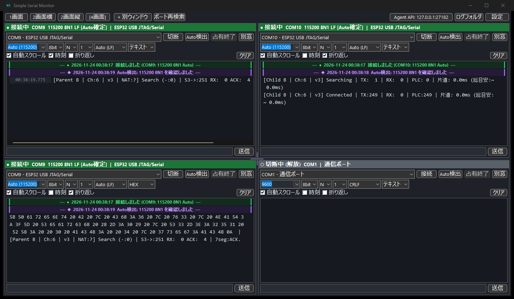

# Simple Serial Monitor (`ssm`)

[English](README.md) | **日本語**

ESP32 / Raspberry Pi / Arduino などの電子工作や独自 UART / バイナリ通信デバッグ向けに設計した、超軽量・ネイティブ Win32 製シリアルモニタ（Rust 実装）です。

Electron・WebView2・.NET・VC++ 再頒布可能パッケージなどの外部ランタイムは一切不要で、ZIP を展開してそのまま実行できます（本体約 500 KB）。



---

## 主な機能

- **ダーク／ライトモード & 日本語／英語切替（設定画面）**
  - ネイティブ Windows ダークモード（タイトルバー・各種コントロール・スクロールバー・設定画面）に対応し、**システム設定に従う / ライト / ダーク** を即時切替できます。
  - **設定**画面から **日本語 / English** の UI 言語をアプリ再起動なしで即座に切り替えられます。
- **通信設定の自動検出 & 手動変更**
  - ボーレート（`115200` / `9600` / `74880` / `57600` / `38400` / `230400` / `460800` / `921600` 等）、データビット（`8/7/6/5`）、パリティ（`N/E/O/M/S`）、ストップビット（`1/1.5/2`）、改行コード（`CRLF`/`LF`/`CR`）を自動検出します。
  - Auto 時は現在の検出値を `Auto (115200)` / `Auto (LF)` のようにドロップダウン内に表示します。
  - いつでも手動変更・カスタムボーレートの手入力が可能です。
- **複数 COM ポートの同時監視（分割表示・ドラッグリサイズ・別ウィンドウ）**
  - **1画面 / 2画面（横・縦） / 4画面（2×2）** をワンクリックで切り替えられます。
  - 分割ペインの境界（4画面時は中央交点も対応）をドラッグして自由にサイズ変更でき、左上のレイアウトボタンを再度押すと均等比率にリセットされます。
  - 複数画面分割に対応した追加ウィンドウ（`+ 別ウィンドウ`）と、指定 COM ポート専用の単一ウィンドウ（`別窓`）を使い分けられます。
- **アクティブ COM ポートの自動列挙 & ハードウェア名表示・新デバイス通知**
  - USB 抜き差し（ホットプラグ）を自動検知し、ESP32 / Raspberry Pi Pico / Arduino / CP210x / CH340 / FTDI / ST-LINK / J-Link 等のデバイス名を表示します。
  - 新しいデバイス接続時の通知方法を **OFF / アプリ内ポップアップ / Windows 通知 / 両方** から選択できます。
- **他プロセスによる占有の検出と終了**
  - 他のプログラムが COM ポートを使用中の場合、プロセス名と PID を赤帯で表示し、`[占有終了]` ボタンから終了して即座に接続できます。
- **わかりやすい状態表示 & 自動再接続**
  - 接続中（緑）/ 自動検出中（青）/ 切断・再接続待機（橙）/ 占有中（赤）/ 解放中（灰）を色分け表示し、USB 抜き差しやマイコン再起動後も自動で再接続します。
- **バイナリ・独自形式パケット表示対応（`テキスト` / `HEX` / `BIN`）**
  - 改行を含まない生バイナリや非 UTF-8 パケットも破棄せず必ず表示します。
  - 受信済みログを含め、**テキスト**（文字化け・制御文字 `·` も可視表示）/ **HEX**（16進ダンプ + ASCII プレビュー）/ **BIN**（2進8bit列）をいつでも瞬時に切り替えられます。
- **見やすく軽量な仮想ログビュー**
  - 接続（緑）・切断（橙）・Auto 検出（紫）・エラー（赤）などのシステムメッセージを背景色・記号付き中央揃えバナーで表示し、デバイス受信（白）・送信（シアン）と明確に区別します。
  - スマート自動スクロール：上へスクロールすると自動で OFF になり、一番下までスクロールすると自動で ON に復帰します。
  - `折り返し` と横スクロール（`Shift + ホイール` 対応）の切替、拡大縮小・リセット（`Ctrl + ホイール` / `Ctrl + ±` / `Ctrl + 0`）、全項目のホバーツールチップ、異なる DPI/解像度モニター間移動（Per-Monitor V2）に対応しています。
- **起動時のウィンドウ配置 & 設定復元**
  - 実行ファイル横の `ssm_config.json` に全ウィンドウ位置・サイズ・分割比率・ポート設定を保存し、次回起動時に復元します。
- **コーディングエージェント同時アクセス対応（Antigravity / Codex / Claude Code 等）**
  - 人間が GUI で監視しながら、エージェントもポート競合なしでリアルタイムにログ読取・送信・書き込み前の一時解放／再接続を行えます。

---

## ショートカット・操作

| 操作 | 方法 |
| --- | --- |
| データ送信 | 送信欄で `Enter` |
| 送信履歴の呼び出し | 送信欄で `↑` / `↓` |
| 表示サイズの拡大縮小 / リセット | `Ctrl + ホイール`、`Ctrl + +` / `-`、`Ctrl + 0` |
| 横スクロール（折り返し OFF 時） | `Shift + ホイール` またはチルト／水平ホイール |
| 選択コピー / 全選択 | ドラッグ選択後に `Ctrl + C` / `Ctrl + A` |
| 分割サイズ変更 / リセット | ペイン間の境界をドラッグ / レイアウトボタンを再度クリック |

---

## コーディングエージェント向けインターフェース

`ssm.exe` 起動中、以下の 4 通りの方法で GUI と同時にシリアルデータを扱えます。

### 1. MCP サーバー（`ssm-cli.exe mcp`）— Antigravity / Codex / Claude Code 推奨

```json
{
  "mcpServers": {
    "simple-serial-monitor": {
      "command": "C:\\path\\to\\SimpleSerialMonitor\\ssm-cli.exe",
      "args": ["mcp"]
    }
  }
}
```

提供ツール:
- `list_serial_ports` — アクティブな COM ポート・ハードウェア名・状態・通信設定・占有プロセス・ログパス一覧
- `read_serial_log` — 最新ログまたは `since_seq` 以降の差分ログを取得（バイナリ時は `raw_hex` 付き）
- `send_serial_data` — 指定ポートへデータ送信
- `control_serial_port` — `connect` / `disconnect`（ファームウェア書き込み前の一時解放）/ `autodetect` / `clear` / `kill-owner`

### 2. CLI (`ssm-cli.exe`)

```powershell
# ポート一覧と状態を表示
.\ssm-cli.exe list

# GUI と同時に最新ログを読む / リアルタイム追従
.\ssm-cli.exe read COM9 --tail 50
.\ssm-cli.exe read COM9 --follow

# コマンド送信
.\ssm-cli.exe send COM9 "help"

# ファームウェア書き込み前に一時解放し、書き込み後に再接続
.\ssm-cli.exe disconnect COM9
# ... esptool / arduino-cli / cargo flash ...
.\ssm-cli.exe connect COM9
```

### 3. ローカル HTTP REST / SSE API (`http://127.0.0.1:27182`)

上部バーの **`Agent API: 127.0.0.1:27182`** ボタンをクリックすると、URL をクリップボードへワンクリックコピーできます（ポート番号は **設定** 画面から変更可能）。

- `GET /api/status` — サーバー状態および全ポートサマリ
- `GET /api/ports?refresh=1` — ポート一覧（JSON）
- `GET /api/logs/COM9?tail=100&since_seq=0&format=json|text` — バッファ済みログ読取
- `GET /api/stream/COM9?format=sse|ndjson` — リアルタイムストリーミング
- `POST /api/send/COM9` — データ送信（`{"data":"...", "eol":"auto"}` またはプレーンテキスト）
- `POST /api/ports/COM9/connect` | `disconnect` | `autodetect` | `clear` | `kill-owner`

### 4. リアルタイムログファイル (`logs/`)

`logs/<PORT>.log` に `[YYYY-MM-DD HH:MM:SS.mmm]` 形式で日付＋時刻付きログがリアルタイム出力されます（読み取り共有モードでオープンしているため、ファイル参照のみのエージェントでも直接読めます）。ポート状態一覧は `logs/status.json` に出力されます。

---

## ソースからのビルド

Windows 上の Rust (`x86_64-pc-windows-msvc`) が必要です。

```powershell
cargo build --release
```

ポータブル ZIP を作成する場合:

```powershell
powershell -ExecutionPolicy Bypass -File .\package_portable.ps1
```

---

<sub>※ 本プロジェクト（プログラムコード・アイコン・ドキュメントを含むすべて）は AI（Google Gemini）によって作成されています。ご利用の際はご自身の責任にて内容をご確認のうえお使いください。</sub>
